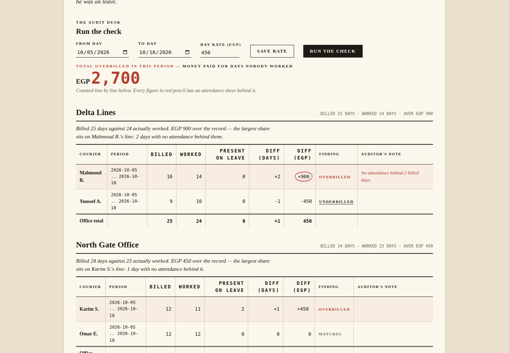

# Office Invoice Checker

An outsourcing office sends one invoice per period: this many courier days, at this day rate, pay us. The station usually pays it because checking it by hand means rebuilding the whole period from attendance sheets. This app keeps the attendance and the leave in the same place as the invoice, so the check is one screen instead of a week of paper.

A worked day is counted the strict way. The courier was present that day, and he was not on leave that day. Present while on leave happens in real sheets more often than anyone admits, and those days are shown in their own column instead of being quietly paid. Every invoice line is compared per courier: billed days, worked days, the difference in days, and the difference in money at the day rate, which is configurable because rates change and last period's rate is not this period's argument. Lines billed above the real days are flagged, and lines billed below are flagged too, because an office that underbills this month usually corrects it with interest next month.

The date range at the top drives everything on the page. Pick the period, the lines inside it are checked, the office totals are rebuilt, and the headline number is the total overbilled money in that period.

## Run it

```bash
cd backend
python3 seed.py
python3 app.py
```

Open http://127.0.0.1:8083 and sign in with the demo accounts user, accounts / demo1234. Local demo only. The seed covers one billing period, 2026-10-05 to 2026-10-18, with five couriers across three invented offices, and the expected results are written next to the seed data so anyone can check the app's arithmetic by hand.

## Import, report and backup

Invoice lines arrive as a CSV import (`POST /api/import/invoice-lines`, accountant and admin accounts only) that validates its columns, rejects broken rows one by one with the row number and the reason, and names the duplicates it skipped instead of double counting a period. Reasons include a courier billed by an office he does not belong to, an unknown office or courier, a backwards period, and billed days outside 0 to 62. `GET /api/report` returns the same check shaped for the printable report view, which draws an inline SVG chart of billed against worked days per office and prints without the screen furniture.

## Configuration

Everything operational comes from environment variables, listed in `config.env.example`.

| Variable | Default | What it does |
|---|---|---|
| `PORT` | 8083 | Port the server listens on |
| `INV_DB` | backend/invoices.db | Database file |
| `INV_TOKEN_TTL` | 28800 | Login token lifetime in seconds |
| `INV_LOG_FILE` | backend/invoice_checker.log | Rotating log file |
| `INV_BACKUP_DIR` | backend/backups | Where backup copies land |

`GET /api/admin/config` reports the live values to admin accounts.

## Backup and restore

`POST /api/admin/backup` with the accounts token copies the live database into the backup directory under a timestamped name such as `invoices-20261024-063000-123456.db` and returns that name and its size. The copy uses the SQLite backup API, so it is consistent even while the app is running. Viewer accounts get a 403.

To restore: stop the server, copy the chosen backup file over the database path from `INV_DB`, and start the server again.

```bash
cp backend/backups/invoices-20261024-063000-123456.db backend/invoices.db
```

## Tests

```bash
python3 tests/test_api.py         # the check itself, on hand worked seed numbers
python3 tests/test_deepening.py   # import report, backup file, config, report shape
```

## Architecture

Python 3 standard library only, REST API over SQLite, a single page frontend that talks only to the API. The frontend is an editorial auditor's ledger — broadsheet rules, Fraunces serif, money in IBM Plex Mono, and a red pencil that circles what should not have been paid; DESIGN.md records the direction and what it deliberately avoids. Passwords are PBKDF2 hashes, bearer token auth on every data route, parameterised SQL, and an invoice line cannot be filed under an office the courier does not belong to. The layout is responsive and the tables scroll sideways on small screens, so it works from a computer, an Android phone, and an iOS phone, though in practice this is desk work. The demo runs locally, there is no public deployment.

## Known limitations

Attendance and leave are entered records, the app does not import them from a payroll system yet, and a wrong attendance sheet produces a confident wrong answer. Invoice lines do import from a spreadsheet export, with the validation described above. Split periods are handled by keeping invoice lines fully inside the chosen range, so a line that straddles the boundary is left out rather than prorated. Money is one flat day rate for everyone in this version, senior couriers at a different rate would need a rate per courier.

## Screenshots



The seeded period checked: EGP 2,700 billed over the work that actually
happened, with the red pencil already around the worst line. All data
on this screen is fictional demo data.
